# Archonbite site brifi: QuizNight tanıtımı

Bu belge, archonbite.com sitesinin QuizNight bölümünü ve stüdyo ana sayfasını hazırlayan kişi için tek kaynaktır. İçindeki her bilgi projenin gerçek durumuna dayanır. Olmayan özellik, fiyat, tarih ya da yorum yazılmamıştır. Görseller `images/` klasöründe, oyundan alınmış gerçek ekran görüntüleridir.

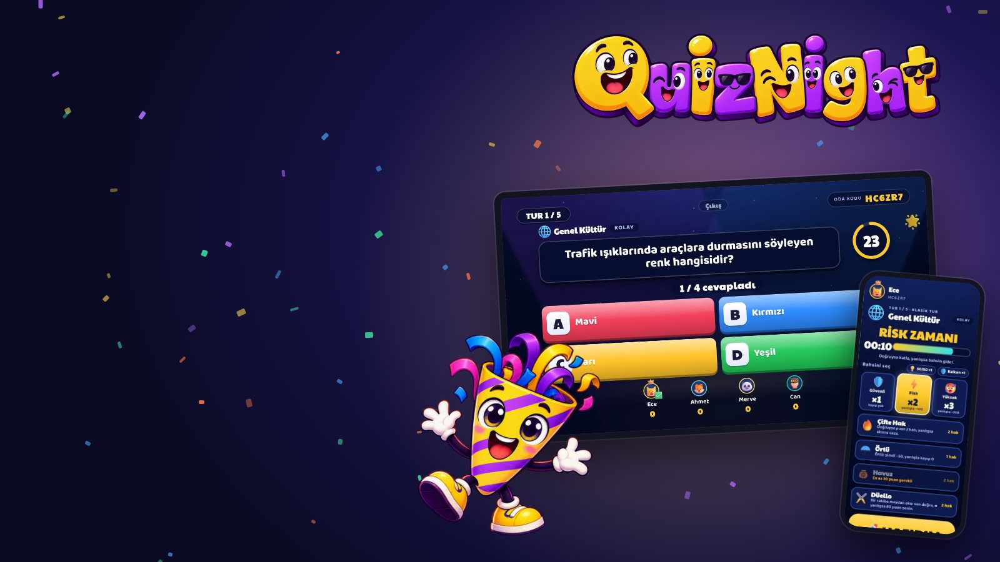

*QuizNight ana görsel (key art)*

> Ton: sıcak, canlı, samimi. Abartı ve slogan kalıpları yok. Cümleler kısa ve doğrudan. Emoji bölüm işareti olarak kullanılmaz. Salty Pirates sayfasının karanlık, sinematik havasından bilerek ayrışır: QuizNight renkli, aydınlık ve enerjik.

## 1. Tek cümlede QuizNight

**TV sahne, telefon kumanda.** Arkadaşlarla aynı masada oynanan bilgi yarışması. Soru büyük ekranda, cevaplar elindeki telefonda. Uygulama indirmek yok, QR okutup giriliyor.

## 2. Kısa açıklama (kart ve paylaşım metni)

QuizNight, TV öncelikli bir parti bilgi yarışması. Televizyonda ya da bilgisayarda oyunu açarsın, ekrandaki QR kodu telefonunla okutursun, takma adını ve takımını seçersin ve yarışırsın. Soru TV'de, şıklar telefonda. Risk al, sabotaj yap, kazanan olsun.

## 3. Uzun açıklama

QuizNight, bir masanın etrafında toplanan insanlar için yapıldı. Büyük ekran sahneyi, telefonlar kumandayı üstlenir. Kimsenin bir şey kurmasına, hesap açmasına ya da uygulama indirmesine gerek yok: TV'de oyunu açarsın, ekrandaki QR kodu okutursun, takma adını seçersin ve oyun başlar.

Her soruda önce kısa bir okuma süresi var. Soru yalnızca TV'de görünür, telefonda yalnızca cevap şıkları durur. Böylece herkes aynı ekrana bakar, konuşur, tartışır. Süre dolmadan cevabını kilitlersin. Cevap açılırken yanlış şıklar teker teker söner, doğru şık parlar ve puanlar sayılır. Seri yakalarsan yanında bir alev belirir.

Oyunu tek başına bireysel oynayabilir ya da masayı takımlara bölebilirsin. Takım adlarını, renklerini ve simgelerini biz belirleriz; oyuncu takma adını seçtiği gibi telefondan takımına dokunur. Takımlar kişi başı ortalama puana göre sıralanır, böylece üç kişilik takım iki kişilikle adil yarışır.

Bir de kafeler için yapılmış bir mod var: personel bir masa açar, süre sayılır, oyun kendi kendine akar, kazanana kafenin belirlediği bir ödül (örneğin bir içecek) kodla verilir. Kafe kendi sorularını da yükleyebilir. İlk mekan Gusto Board Game Cafe (Çanakkale).

Ses ve görünüm baştan tasarlandı: tek bir müzik ailesinden üretilmiş özgün sesler, kademeli cevap açılışı, seri alevi, son üç saniyede kenar nabzı, podyum konfetisi. Türkçe ve İngilizce arayüz, yüksek kontrast teması ve hareketi azaltma desteği var.

## 4. Öne çıkan özellikler

- **TV sahne, telefon kumanda.** Soru büyük ekranda, cevaplar telefonda. Herkes aynı ekrana bakar.
- **Kurulum yok.** Tarayıcıda çalışır. QR kodu okut ya da oda kodunu yaz, gir.
- **Takım ya da bireysel.** Masa takımlara bölünebilir. Takım adı, rengi ve simgesi hazır; oyuncu sadece dokunur.
- **Basit mod.** Kafeler için sade kurallar: 50/50, çift puan ve üç kolay sabotaj. Beş saniyede anlaşılır.
- **Risk ve sabotaj.** Tam modda bahis seviyeleri, düello, havuz ve sekiz farklı sabotaj var. Her sabotajın sınırı ve karşı hamlesi (kalkan) bellidir.
- **Süre dengeli.** Basit modda standart sorularda 30 saniye. Okuma süresi önce gelir, şıklar sonra açılır. Soru yalnızca TV'de olduğu için hazır cevabı aramak zordur.
- **Kafe modu.** Süreli masalar, kazanana ödül kodu, kafenin kendi soruları, personel paneli.
- **Doğrulanmış soru bankası.** 35 kategori, ilk yayın bankasında yaklaşık 850 yayında Türkçe soru. Genel kültür, tarih, bilim, spor, Türkiye kültürü, masa oyunları, Çanakkale ve yöresi, 90'lar nostaljisi ve çok sevilen dizi ve film evrenleri.
- **Ses ve animasyon.** Özgün üretilmiş ses paleti, kademeli cevap açılışı, seri alevi, podyum.
- **Erişilebilir.** Şıklar yalnızca renkle değil harf ve şekille ayrılır. Yüksek kontrast teması ve hareketi azaltma seçeneği var.
- **Türkçe ve İngilizce.** Her telefon kendi dilinde oynar.

## 5. Bir akşam nasıl geçer?

1. TV'de ya da bilgisayarda QuizNight'ı aç. Ekranda QR kod ve oda kodu çıkar.
2. Herkes telefonuyla QR kodu okutur, takma adını seçer. Takım modunda takımına dokunur.
3. Lider oyunu başlatır. Tur sayısı ve zorluk lobide seçilir.
4. Kısa hazırlık: çift puan kullanmak ya da rakip takıma sabotaj yapmak isteyenler seçer.
5. Soru TV'de görünür, şıklar telefonlarda açılır. Süre işlerken cevabını kilitlersin.
6. Cevap açılır: yanlışlar söner, doğru şık parlar, puanlar sayılır.
7. Tüm turlar bittiğinde finalde sorular iki kat puan verir. Podyumda kazanan ya da kazanan takım çıkar.
8. İstersen rövanş: aynı takımlarla tekrar.

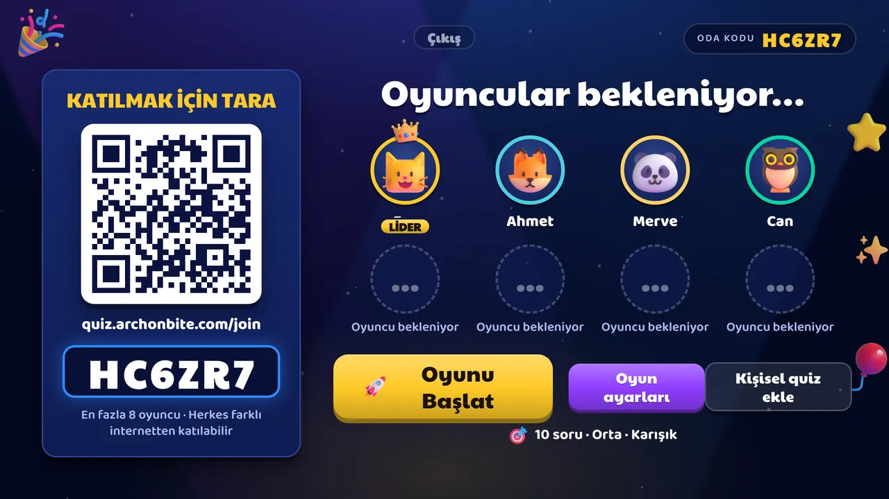 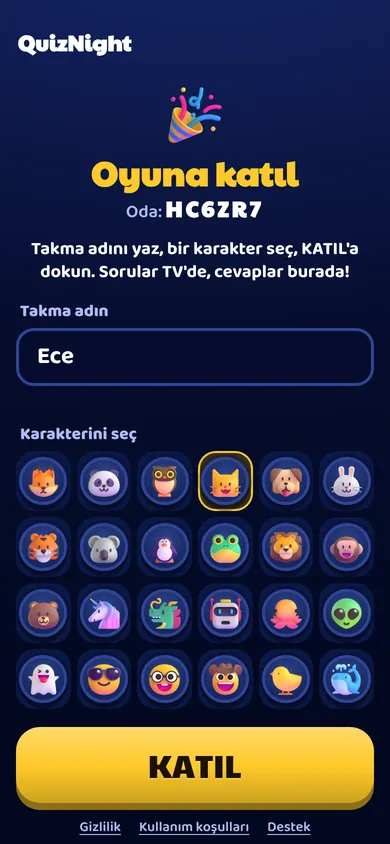

*TV lobisi · Telefonda katılma*

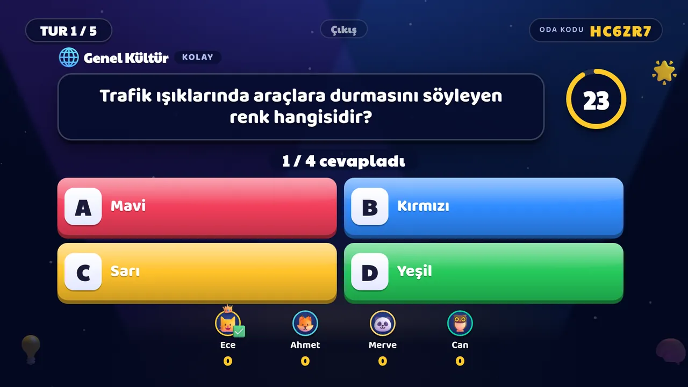 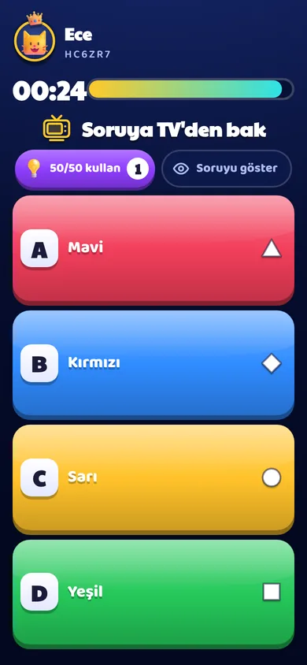

*TV'de soru · Telefonda şıklar*

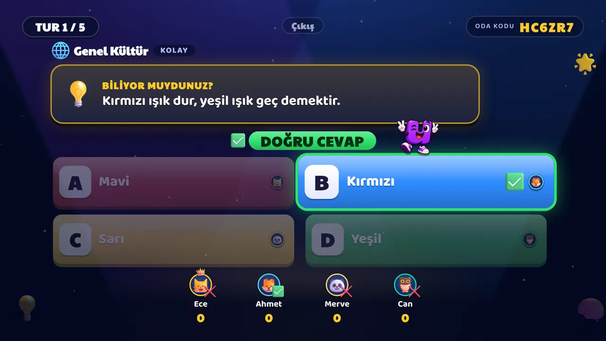

*Cevap açılışı: yanlış şıklar söner, doğru şık parlar*

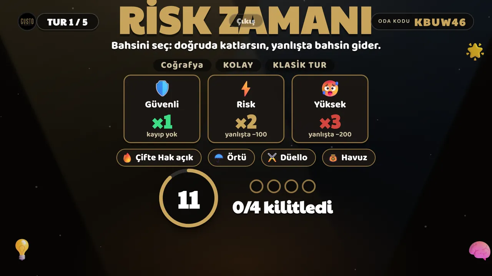 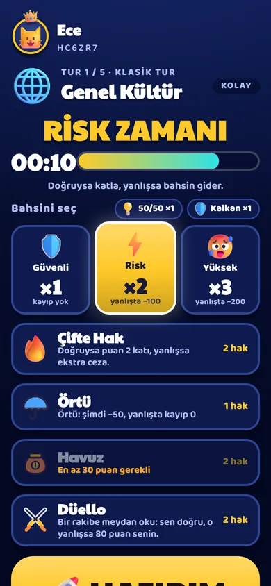

*Hazırlık: risk · Telefonda risk seçimi*

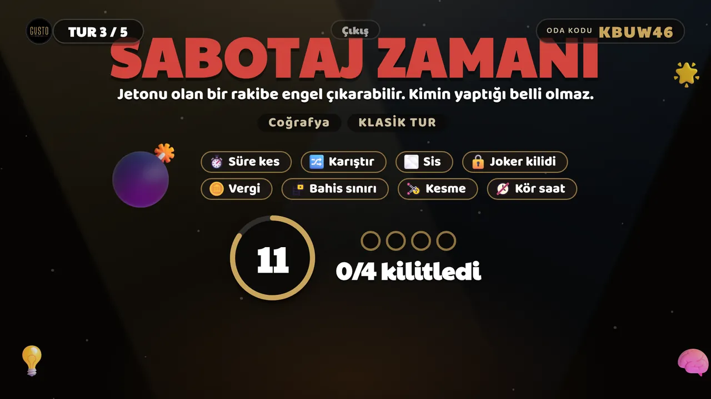 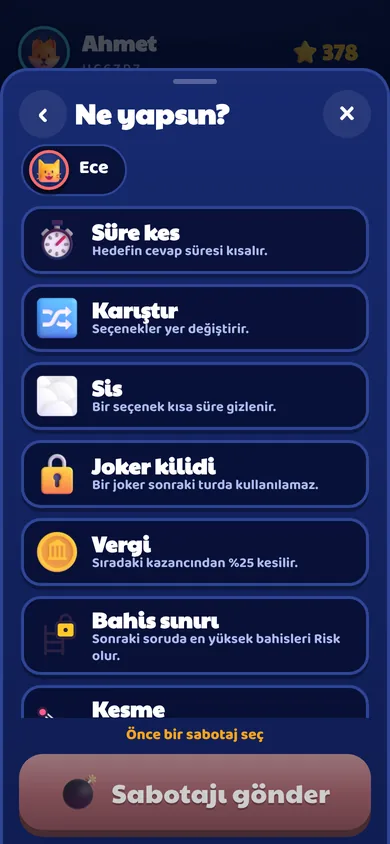

*Hazırlık: sabotaj · Telefonda sabotaj seçimi*

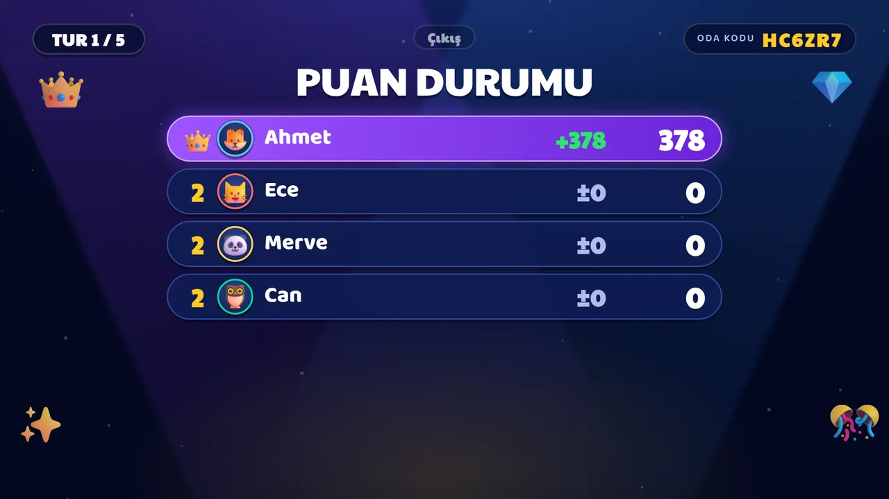 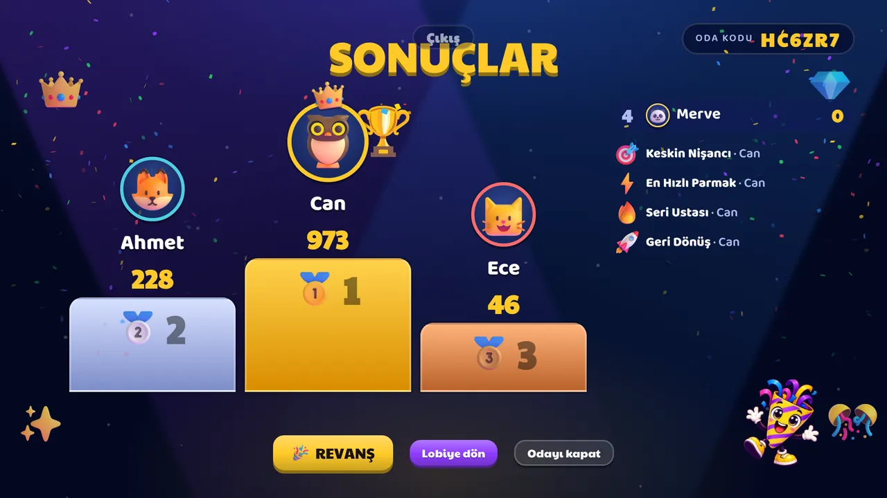

*Skor ekranı · Podyum ve sonuçlar*

## 6. Takım modu: kurallar

- Takım adları bizden: **Kaplanlar, Baykuşlar, Tilkiler, Aslanlar, Ayılar, Ejderhalar, Balinalar, Penguenler.** Her takımın bir simgesi ve rengi var. Renk tek ipucu değildir, ad ve simge de görünür. Kafe isterse takım adlarını kendi adlarıyla değiştirebilir.
- Oyuncu takma adını seçer, sonra takımına dokunur. Yeni gelen en küçük takıma düşer, istediği takıma geçebilir. Lider başkasını da taşıyabilir.
- Herkes tek tek cevaplar ve puan toplar. **Takımlar kişi başı ortalama puana göre sıralanır;** toplam puan yanında görünür. Eşitlikte doğru sayısı ve süre bakılır.
- Takımlar arasında en fazla bir kişi fark olabilir. Fazlası olursa oyun başlamaz.
- Sabotaj rakip takıma yapılır ve takımın tüm üyelerine ulaşır. Kalkan takıma aittir, bir vuruşu tümüyle engeller.
- Kazanan takıma kafe ödül veriyorsa tek kod çıkar. Kod takımın en iyi sıradaki bağlı üyesinin telefonuna gider; masada ödülü nasıl paylaşacaklarına kafe karar verir.

## 7. Basit mod ve tam mod

|  | Basit mod (kafe) | Tam mod |
|---|---|---|
| Cevap süresi (standart) | 30 saniye | 25 saniye |
| Hız turu / final | 12 s / 20 s | 12 s / 20 s |
| Güçlendirmeler | 50/50, çift puan, kalkan | Aynı, ayrıca bahis seviyeleri, düello, havuz, siper |
| Sabotajlar | Süre kısaltma, şıkları karıştırma, saati gizleme | Sekiz sabotaj |
| Hazırlık | Tek kısa ekran (en fazla 10 sn), gerek yoksa atlanır | Risk ve sabotaj için ayrı iki ekran |

> Bu tablodaki sayılar projenin ayarlarından alınmıştır (ADR-0026). Kafe cevap süresini 10–60 saniye arasında değiştirebilir.

## 8. Kafe modu

- Personel kendi telefonundan **Mekan paneli**ne e-posta koduyla girer. Bir TV odasını kodla ya da TV'deki QR ile masaya bağlar ve süre seçer (saatlik, uzatılabilir).
- Sayaç TV'de görünür. Süre bitince oynanan tur tamamlanır, sonra "Süre doldu" ekranı gelir. Personel +15, +30 ya da +60 dakika ekleyebilir.
- Kazanana ödül kodu çıkar. Kod yalnızca kazananın telefonunda görünür, tek kullanımlıktır ve en az dört saat (ya da gece yarısına kadar) geçerlidir. Kasada panelden doğrulanır.
- Kafe kendi sorularını CSV ya da JSONL dosyasıyla yükleyebilir. Hatalı satırlar Türkçe açıklamayla gösterilir.
- Sistem para yönetmez. Giriş ücretini ve ödülü kafe kendi belirler.

> Gusto Board Game Cafe adını ve logosunu kullanmak için kafeden izin alınmalıdır. İzin yoksa Gusto geçen görsel ve cümle kaldırılır.

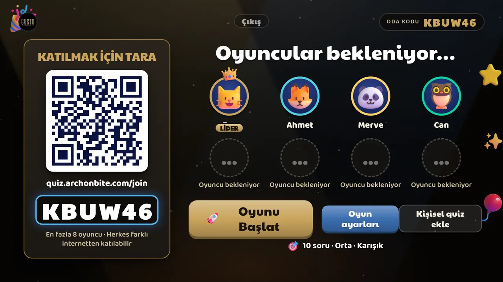

*Gusto temasıyla TV lobisi (kafe teması)*

## 9. Soru bankası

35 kategori. İlk yayın bankasında yaklaşık 850 yayında Türkçe soru var. Küçük kategoriler (15 sorunun altı) lobide listelenmez. Kategoriler:

Genel kültür, Tarih, Coğrafya, Bilim, Doğa, Teknoloji, Sanat ve kültür, Edebiyat, Sinema ve TV, Müzik, Oyun, Spor, Yeme içme, Mitoloji ve halk inanışları, Dil ve kelimeler, İş ve ekonomi, Matematik ve mantık, Game of Thrones, Harry Potter, Warhammer, Breaking Bad, Better Call Saul, The Office, How I Met Your Mother, Marvel, DC, Hollywood, Kült filmler, Türkiye kültürü, Yeşilçam ve Türk dizileri, Çanakkale ve yöresi, Masa oyunları, Anime ve çizgi film, 90'lar nostaljisi, Futbol (Türkiye).

> Dizi, film ve oyun evrenleri için siteye kısa bir not konmalı: QuizNight bu yapımlarla bağlantılı ya da onlar tarafından onaylı değildir; adlar yalnızca soru konusunu belirtmek için kullanılır.

## 10. Ses ve görünüm

- Sesler tarayıcıda üretilir, hazır ses dosyası ya da lisans sorunu yoktur. Hepsi aynı müzik tonunda (Do majör), çan, marimba ve yumuşak davul ailesinden.
- Geri sayım son üç saniyede hızlanır. Doğru cevap seriye göre yükselen bir arpejle çalar, yanlış cevap yumuşak bir ses çıkarır.
- Cevap açılışı: davul yuvarlanması, yanlış şıklar teker teker söner, doğru şık parlar ve konfeti çıkar.
- Seri yakalayan oyuncunun yanında alev görünür. Son üç saniyede ekran kenarı nabız atar, telefon titrer.
- Hareketi azaltma tercihi olan kullanıcılarda büyük hareketler kapanır.

## 11. Sık sorulan sorular

| Soru | Cevap |
|---|---|
| Ne gerekiyor? | Bir TV ya da bilgisayar ekranı ve oyuncu başına bir telefon. İnternet bağlantısı şart. Uygulama indirilmez. |
| Kaç kişi oynayabilir? | 2 ile 8 kişi. Takım modunda en az iki takım gerekir. |
| Hangi tarayıcıda çalışır? | Güncel Chrome ve Edge ile denendi. Safari, Firefox ve TV tarayıcıları için cihaz testleri sürüyor. |
| Telefondan hazır cevabı aratmak mümkün mü? | Soru yalnızca TV'de görünür ve süre kısadır. Bu, kolay yolu kapatır ama kararlı birinin ikinci bir telefonla aramasını tamamen engelleyemez. |
| Hesap açmam gerekiyor mu? | Oyuncular için hayır. Takma ad yeter. |
| Hangi veriler toplanıyor? | Oyun için gerekli geçici bilgiler (takma ad, cevaplar). Ayrıntı gizlilik sayfasında. Metin avukat tarafından onaylanmalıdır. |
| Kafe için fiyat? | Anlaşmaya göre. Sitede fiyat yazılmaz. |
| Hangi diller? | Türkçe ve İngilizce. Sorular şimdilik Türkçe. |
| Çocuklar oynayabilir mi? | Sorular genel kültür ağırlıklıdır. Yaş sınırı kararı henüz verilmedi, sitede yaş iddiasında bulunmayın. |

## 12. Kafeler için kısa çağrı

- Müşterin masada kalsın: süreli masa, kendi kendine akan quiz gecesi.
- Kazanana ödül: kod ile, kasada tek tıkla doğrulama.
- Kendi sorularını yükle, kendi renklerini kullan.

İletişim: **TODO-OWNER** (gerçek bir e-posta adresi). Sitede yer tutucu `hello@archonbite.com` yazıyor.

## 13. Stüdyo ana sayfası için metin önerisi

**Başlık:** Aynı masada oynanan oyunlar.

**Giriş:** Archonbite, bağımsız bir oyun stüdyosu. İki oyunumuz var: insanları aynı masaya toplayan QuizNight ve Salty Pirates.

**Hakkımızda:** Küçük bir ekip olarak oyunları yavaş ve titiz yapıyoruz. QuizNight'ta televizyon sahne, telefon kumanda, sunucu ise oyun yöneticisi. Her şey tarayıcıda çalışır. Salty Pirates ise fırtınalı sularda geçen bir korsan hayatta kalma oyunu.

> Salty Pirates ile ilgili cümleler PC'deki Salty Pirates sayfasındaki metinlerle uyumlu olmalıdır. Bu belgede o oyunun içeriği yer almaz.

## 14. Görsel yönerge (QuizNight sayfası)

- **Duygu:** Aydınlık, canlı, bir akşam eğlencesi. Salty Pirates karanlık ve sinematik, QuizNight ise renkli. İkisi aynı site kimliğinde (Archonbite amblemi, altın vurgu) buluşur.
- **Renkler:** Koyu lacivert zemin, canlı şık renkleri (turuncu, mavi, sarı, yeşil), altın vurgu. Gusto temasında gri-siyah ve altın.
- **Tipografi:** Başlıkta Bricolage Grotesque, metinde Inter (ikisi de sitede yerel dosya olarak var). Salty sayfasındaki gotik yazı QuizNight'ta kullanılmaz.
- **Açılış:** Gerçek oyundan sessiz döngü video: takım lobisi, cevap açılışı, podyum. Hareket kapatma düğmesi ve hareketi azaltma desteği şart.
- **Bölümler arası büyük cümleler:** "TV sahne, telefon kumanda." "Soru ekranda, cevap elinde." "Takımınla kazan." "Bir akşam, bir masa, tek kazanan."
- **Üç kart:** "Bir akşam nasıl geçer?" bölümü, Salty sayfasındaki üç kart gibi çevrilir: Katıl, Yarış, Kazan. Her kartta gerçek bir ekran görüntüsü.
- **Takım rozetleri:** Sekiz takım simgesi bir sıra halinde.
- **Galeri:** Telefon ve TV görüntüleri çift sıra. Tıklayınca büyütülür.

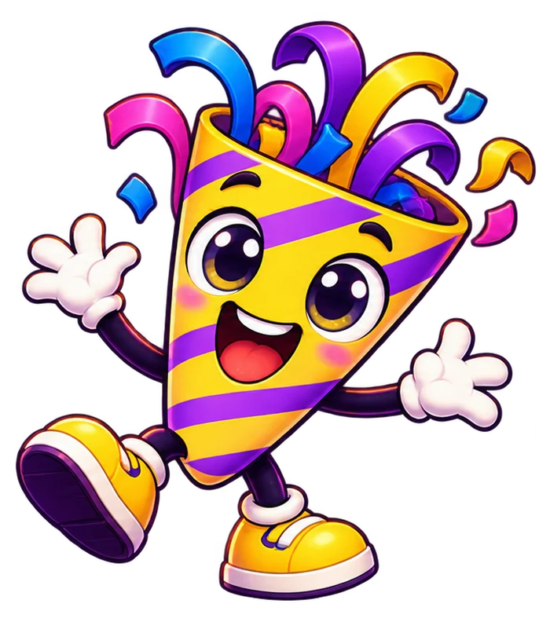

*QuizNight maskotu*

## 15. Teknik notlar (siteyi bağlayan kişi için)

- Oyunun adresi tek bir ayarda: `sites/archonbite/assets/config.js` içindeki `PLAY_URL` (şimdilik `https://quiz.archonbite.com`) ve `PLAY_LIVE`. Oyun adresi açılana kadar `PLAY_LIVE=false` kalır.
- **Oyun siteye iframe ile gömülmez.** Oyun güvenlik başlığıyla gömülmeyi bilerek engeller, çerez ve WebSocket kullanır. Sitedeki "Oyna" düğmesi bağlantıdır.
- Oyun sunucusunda `PUBLIC_WEB_URL` ve `ALLOWED_ORIGINS` aynı adres olmalıdır, yoksa TV bağlantısı reddedilir.
- Dil dosyaları `assets/i18n/tr.json` ve `en.json`. İki dilde anahtarlar aynı olmalı (`node sites/archonbite/tools/check.mjs` kontrol eder).
- Resimlere genişlik ve yükseklik ver, aşağıdakilere `lazy` ekle. Dışarıya hiçbir istek yapılmaz, çerez ve takipçi yoktur.

## 16. Sahibinden gelecek / karar bekleyenler

- Gerçek iletişim e-postası.
- Gusto adı ve logosu için kafenin izni.
- QuizNight fiyatı: yok. Sitede "Fiyat henüz belirlenmedi" kalır.
- Gizlilik ve yasal sayfaların avukat onayı.
- İngilizce metinlerin ana dili İngilizce biri tarafından okunması.
- Fragman: varsa YouTube adresi.
